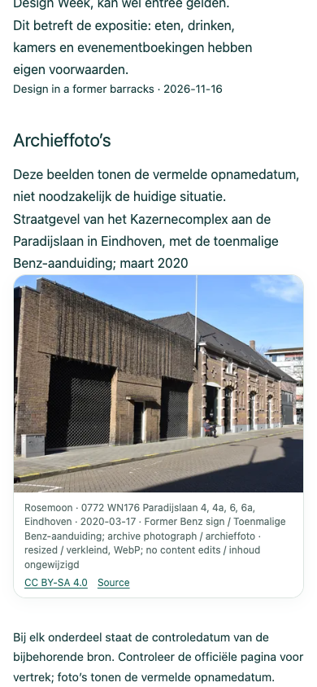
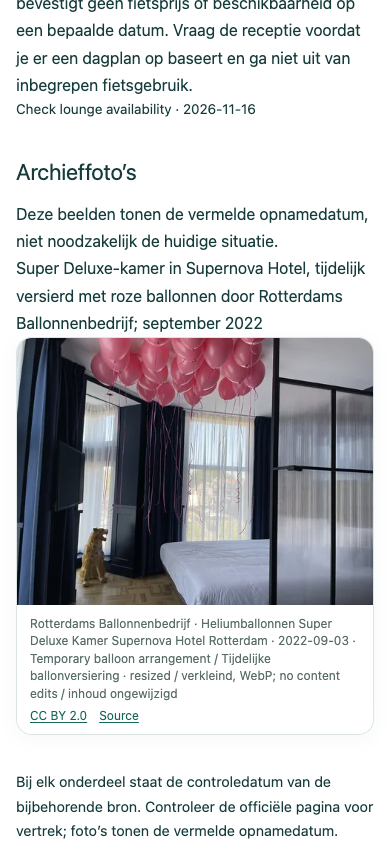
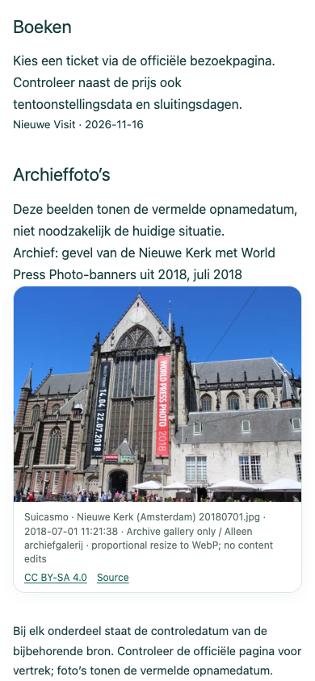
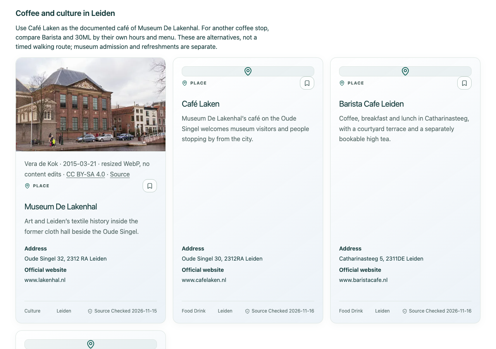

# QA интеграционного кандидата PR75

> Обновление: точные редакционные одобрения получены. [Текущее состояние обычного кандидата](APPROVED_RELEASE_RU.md). Ниже сохранён отчёт предыдущей приватной подготовки; его результаты не заменяют QA одобренного артефакта.

Проверка 16 ноября 2026. **Это приватный редакционный кандидат, не опубликованный production-релиз.** Точные материалы и решения: [REVIEW_RU.md](REVIEW_RU.md).

## Среда и проверенный результат

- Существующий Next.js / governed pipeline, Node 24.22.1; новых зависимостей нет.
- Hostinger `qa-catalog.younew.nl`: существующая Basic-auth защита, HTTP `no-store` / `noindex`, обычный Chrome через установленный Playwright. Browser plugin отсутствует. Приватный артефакт: `2b617cbf5b825e7d760df311418c109e2cd265563511f8d95ac755c1c14426a7`.
- **195 HTTP-проверок PASS:** 86 EN/NL страниц изменённых объектов, общие страницы/JSON и варианты изображений; точное совпадение с файлом кандидата, корректный 404. Анонимный запрос к странице, изображению и JSON получает 401.
- **258 браузерных проверок карточек PASS:** 43 × EN/NL × 390/412/1280 px. Источники, даты, весь текст блоков, лицензии, авторство, загруженные изображения, один H1, self-canonical, взаимный hreflang, отсутствие горизонтального скролла и draft/noindex проверены.
- **39 проверок общих экранов PASS:** home, Leiden, города, Amsterdam, категории, поиск, карта, Saved, guides, BUSINESS, status. Проверены четыре подборки на существующей странице.
- **Интеракции PASS:** Save → перезагрузка → Saved → карточка → remove для ARTIS, Kazerne и Supernova. Дополнительно EN/NL, Share через clipboard, поиск на карте, переход категории и глобальный поиск. Native Share не запускался.
- На Hostinger в финальных проходах нет ошибок/предупреждений консоли. После каждого прохода прежний QA pointer и байты главной/Г01 EN/NL восстановлены; production не переключался.
- Приватный статический пакет: **696 HTML, 42 231 внутренних ссылок/ресурсов**, битых ссылок не найдено. Security scan: известных секретов нет, изображения соответствуют HTTPS CSP, Hostinger-заголовки присутствуют.
- 177 внешних URL проверены: 174 автоматических 200 и три 200 в обычном Chrome. Это доступность выбранных источников и лицензий, а не полный аудит всего сайта. Сохранены отдельные доказательства для OBA и Trompenburg; 429 не обходился.

Подробные машинные результаты: [HTTP](qa-http-result.json), [карточки](qa-page-checks.json), [браузер](qa-browser-check.json), [действия](qa-interactions-check.json), [ссылки](source-link-results.json), [инвентарь](inventory.json).

## Исправления и границы тестов

Архивные фотографии больше не могут стать hero/thumbnail/map fallback; они выводятся только в подписанной архивной галерее. Supernova сохраняет натуральные 1024 px. Подборки используют существующие ID, карточки и источники. Исходные approvals и замороженные файлы не менялись.

Новый набор регрессий проверяет точность двух selection, 43 ID, две безопасные композиции, невозможность активации без пяти отдельных решений, архивный fallback, EN/NL, отсутствие числовых часов Nieuwe Kerk и неизменность обычного публичного каталога. Старые тестовые фикстуры дополнены новыми файловыми зависимостями selection; проверки запрета унаследовать одобрение сохранены. Тест реального рендера ContentMedia проверяет новый путь интеграции без запросов 1200/1920 для Supernova.

Первые локальные браузерные проходы выявили сбои соединений простого Python preview-сервера; увеличена очередь локального сервера. Ошибки не скрывались как успешная приёмка. Для итоговой визуальной приёмки используется полный успешный Hostinger QA. Статический smoke также поймал `image:null` в необязательном поле карты: исправлено на отсутствие поля, существующая проверка не ослаблена. Один дополнительный сценарий Saved сначала ожидал URL без завершающего `/`; после исправления селектора сценарий прошёл на QA.

Полный обычный predeploy прошёл: 299 тестов, 2608 поисковых проверок, 648 sitemap URL, 676 HTML и 40 612 внутренних ссылок/ресурсов; все 10 стадий PASS. После последующей правки только оформления заголовков подборок приватная сборка и lint также пройдены. GitHub CI фиксируется в описании интеграционного Draft PR для точного коммита; результат старого HEAD PR75 не переносится на новый код.

## Резервные копии и откат

Hostinger: `/home/u246392949/domains/younew.nl/younew-private/pr75-integration-production-20261116`.

- 2106 файлов текущего production, архив SHA-256 `45fcfb5ced8ee5e5c46154b1bc5caefc523bdff63149ef39aea8b0449fcd1d43`.
- Все восстановленные файлы сверены с исходным SHA-256-манифестом. Настройки runtime сохранены отдельно; они не включены в Git.
- Согласованный дамп **32 таблиц**, SHA-256 `041ed119ca0657913f0586d26267bcd0325c72773b2493b52c3a0ede0775df03`; схема и реальные данные не изменялись. SQLite-очередь сохранена штатным backup API с `integrity_check=ok`.
- **Именно приватный кандидат** и восстановленная копия production переключены вперёд/назад в изолированных каталогах посредством существующего atomic exchange. Все хеши после обоих переключений совпали. [Результат](private-candidate-rollback.json).
- Приватные локальные копии публичного архива и SQL-дампа дополнительно сверены с сервером, доступ к файлам 0600. [Проверка](local-backup-verification.json).
- Восстановление SQL в реальную базу не выполнялось: статический релиз не изменяет базу, и откат сайта не должен стирать новые заявки. Проверка финального production-кандидата и свежести backup потребуется перед разрешённым выпуском.

## Что ещё не подтверждено

Редакционные решения владельца и точное разрешение на production отсутствуют. Пока эти условия не выполнены, публичный сайт остаётся прежним. Обычный каталог: 96 сущностей; приватный кандидат: 106. `/status/` не повышает готовность всей платформы.

Полевые Core Web Vitals, измеренный INP, настоящий Safari/iPhone, App Store Connect и синхронизация iOS не проверены. LCP/CLS из браузерного журнала — лабораторные наблюдения без throttling и не доказательство полевых порогов. Для будущих сеансов Browser plugin можно подключить отдельно; текущие проверки уже выполнены имеющимися средствами без расходов.

## Скриншоты защищённого QA

