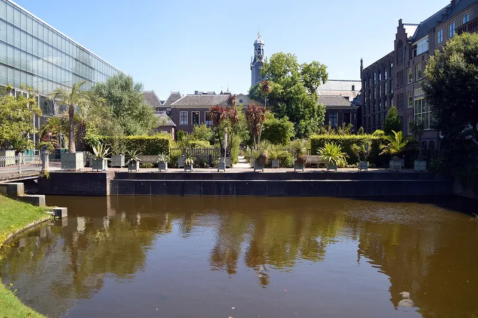
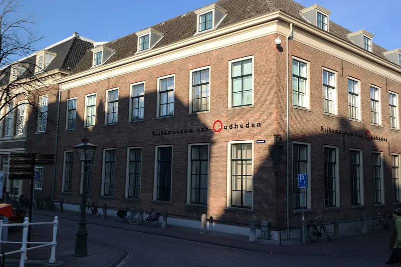
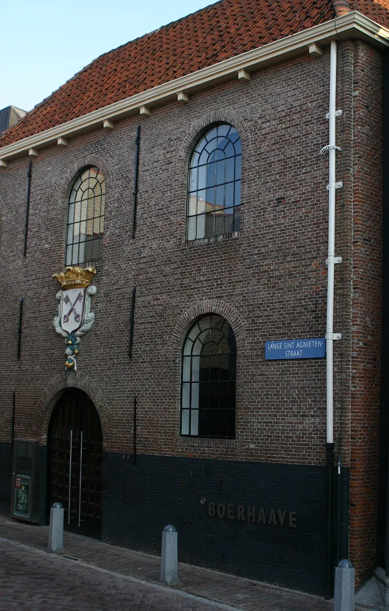
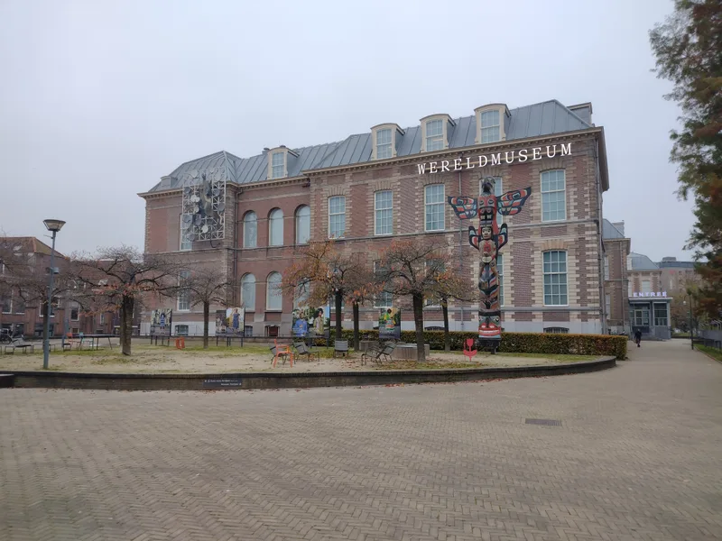

# Leiden: remaining media, coordinates and ticket links ready for review

Prepared 2026-11-15. **Not activated in the iOS production-data bundle.**

This review covers only four missing photos, five missing coordinates and six ticket URLs for the seven existing Leiden cards. It does not approve the other pending descriptions, prices, opening hours, replacement photos for Lakenhal/Naturalis, or park records. The source batches retain their `needs_review` / `publicationAuthorized: false` state. Source-file and derivative hashes are bound in [the exact selection](LEIDEN_COMPLETION_SELECTION_2026-11-15.json), SHA-256 `bfada10e8b2ef709ab52bfebf347131fec619545717b8e9246c0b87e8f30cead`.

## Four photos

Three photos were already prepared in the first review batch. All three were visually inspected again and their Commons license pages checked. The missing Wereldmuseum original was downloaded successfully this time, visually inspected, matched to the Commons SHA-1, and resized to 480/800/1200 px WebP. The three new derivatives total 243,986 bytes. They are historical photographs, not claims about today's appearance. All variants are proportional resizes without content edits; retain credits, source/license links and modification disclosure. ShareAlike applies to the corresponding derivatives.

| Place | Photographer | Capture date | License and source |
| --- | --- | --- | --- |
| Hortus | Roger Veringmeier | 2024-08-07 | [CC BY 4.0 / Commons](https://commons.wikimedia.org/wiki/File:Hortus_botanicus_Leiden.jpg) |
| RMO | Steven Lek | 2018-02-23 | [CC BY-SA 4.0 / Commons](https://commons.wikimedia.org/wiki/File:Dutch_National_Museum_of_Antiquities_Leiden.jpg) |
| Boerhaave | Goodness Shamrock | 2009-04-19 | [CC BY-SA 3.0 / Commons](https://commons.wikimedia.org/wiki/File:Exterior_of_the_Boerhaave_museum.jpg) |
| Wereldmuseum | Sneeuwvlakte | 2024-11-08 | [CC BY-SA 4.0 / Commons](https://commons.wikimedia.org/wiki/File:Wereldmuseum_Leiden_(nov_2024).jpg) |

Hortus — Roger Veringmeier, CC BY 4.0, resized:

RMO — Steven Lek, CC BY-SA 4.0, resized:

Boerhaave — Goodness Shamrock, CC BY-SA 3.0, resized:

Wereldmuseum — Sneeuwvlakte, CC BY-SA 4.0, resized:

## Five coordinates

| Place | Latitude | Longitude | Evidence and limitation |
| --- | --- | --- | --- |
| Naturalis | 52.1646451 | 4.4730775 | Destination in the official visitor page walking-route link; already documented in first review |
| RMO | 52.1584668 | 4.4858978 | Destination pin linked from official visitor information; already documented in first review |
| Boerhaave | 52.16134171 | 4.48917759 | PDOK/BAG match of the official address; address centroid, not surveyed entrance |
| Burcht | 52.15831 | 4.492962 | Official Visit Leiden route destination; already documented in second review |
| Wereldmuseum | 52.16324 | 4.48245 | Newly extracted from [Visit Leiden](https://www.visitleiden.nl/nl/locaties/3715984452/wereldmuseum-leiden)'s route link; address agrees with museum visitor information |

Exact source URLs/methods are in the selection and the existing batch coordinate evidence. No camera centre, photo EXIF position, city centre, fabricated distance or travel duration was used. The Google route URL is evidence only; user navigation remains Apple Maps. No Google API was purchased or integrated.

## Six ticket links

All six direct GET checks returned HTTP 200 on 2026-11-15; final URLs and official referring pages are recorded in the selection. This verifies reachability, not a purchase transaction or ticket availability. No checkout was submitted.

- [Lakenhal](https://tickets.lakenhal.nl/en/tickets)
- [Naturalis](https://www.naturalis.nl/en/tickets-for-naturalis)
- [Hortus](https://tickets.hortusleiden.nl/nl/tickets)
- [RMO](https://ticket.rmo.nl/en-EN/tickets) redirects to the same service's `/en-US/tickets`.
- [Boerhaave](https://tickets.rijksmuseumboerhaave.nl/)
- [Wereldmuseum](https://leiden.wereldmuseum.nl/nl/tickets)

Burcht retains no ticket action: no verified ticket URL is supplied.

## Changes and verification

- Completed the existing Wereldmuseum review record's media, route coordinate, source evidence and EN/NL image descriptions. Updated its existing batch manifest hashes; approval fields unchanged.
- Added three optimized Wereldmuseum assets; reused the existing three other photos instead of duplicates.
- Updated the existing private-preview regression for four known coordinates and one licensed image in that five-record batch. Other pending park images remain absent.
- Added a selection regression that binds reviewed source files, all 12 image variants, coordinates and ticket URLs to the exact review request.
- **17 tests passed**, 0 failures: existing editorial/review tests plus iOS projection and selection checks. The approved seven-record iOS projection remains byte-for-byte reproducible and excludes review data.
- Xcode `build-for-testing` succeeded using the existing project and `/tmp/younew-leiden-build`; log `/tmp/leiden-complete-review-build.log`. Swift source and iOS resource files were not changed in this batch.
- No available iOS Simulator runtime was present in the preceding check; no Simulator run, image rendering, ticket-button interaction or Swift test execution is claimed for this review batch.
- Production, TestFlight, App Store, the original 71-record approval, user settings and Saved data were not changed.

## Approval required for activation

The original approval in `DataProject/editorial/leiden-20261110-approval.json` has `scope.images: "none"` and binds the original file hashes. Both richer source manifests explicitly say `publicationAuthorized: false`; their reviewer and approval date are null. Completing source verification does not turn that into a human editorial approval. The existing rules are documented in [DataProject/editorial/README.md](../../DataProject/editorial/README.md).

Requested decision: approve **only the exact 4-photo / 5-coordinate / 6-ticket selection above** for integration into the existing iOS cards, keeping production and App Store unchanged. The larger pending review batches remain pending outside those fields. After approval, activation must use a hash-bound approval record and the governed exporter; it must not simply flip the entire batches to published.
