# Travel content: exact owner review request

**Pending human approval. No new runtime content has been activated.**

Selection SHA-256: `d00afc1621010eba612be3dc397c08a3b0f3a2633538fbe825697b00b8e0dca7`.

Proposed scope: **57 EN/NL records, 32 photographs, 33 address coordinates, 6 collections**. All object IDs already exist in the PR #70 review index; no additional entities are introduced here.

This request includes photographs of existing park entries. It does not approve other park draft fields, prices, hours or ticket links. The earlier 4-photo / 5-coordinate / 6-ticket approval remains unchanged.

Approval will permit subsequent implementation through the governed exporter; it will not itself activate records, publish entire packages or authorize a merge/deployment. The exporter currently supports the earlier Leiden selection only; support for this new exact selection must be implemented and tested after approval.

## EN/NL text and official sites

These are proposed source-backed descriptions, not new reviews or ratings. Nine unresolved primary sources are excluded. Historical base files and publication flags are unchanged.

| ID / city | EN | NL | Official source |
|---|---|---|---|
| `museum.leiden-de-valk` / leiden | Explore Leiden's windmill museum and the history of milling inside De Valk. | Ontdek het Leidse molenmuseum en de geschiedenis van het malen in De Valk. | [Molenmuseum De Valk](https://molenmuseumdevalk.nl/) |
| `museum.leiden-sieboldhuis` / leiden | Explore Japanese art and culture through the collections and exhibitions of SieboldHuis. | Ontdek Japanse kunst en cultuur via de collecties en tentoonstellingen van SieboldHuis. | [Japanmuseum SieboldHuis](https://www.sieboldhuis.org/en/) |
| `place.leiden-pieterskerk` / leiden | Discover Pieterskerk, a historic Leiden church that now hosts cultural programmes and events. | Ontdek de Pieterskerk, een historische Leidse kerk met culturele programma's en evenementen. | [Pieterskerk Leiden](https://www.pieterskerk.com/en/) |
| `place.leiden-young-rembrandt-studio` / leiden | Discover the early Leiden years of Rembrandt through the Young Rembrandt Studio presentation. | Maak via de presentatie van de Young Rembrandt Studio kennis met Rembrandts vroege Leidse jaren. | [Young Rembrandt Studio](https://www.visitleiden.nl/nl/cultuur/jonge-rembrandt/young-rembrandt-studio) |
| `place.leiden-schouwburg` / leiden | Explore theatre and live performance at the Leidse Schouwburg. Choose a performance from the venue's current programme. | Ontdek theater en livevoorstellingen in de Leidse Schouwburg. Kies een voorstelling uit het actuele programma. | [Leidse Schouwburg](https://leidseschouwburg-stadsgehoorzaal.nl/) |
| `museum.rijksmuseum` / amsterdam | Explore Dutch art and history at the Rijksmuseum, with works by Rembrandt, Vermeer and Van Gogh. | Ontdek Nederlandse kunst en geschiedenis in het Rijksmuseum, met werk van Rembrandt, Vermeer en Van Gogh. | [Rijksmuseum](https://www.rijksmuseum.nl/en) |
| `museum.van-gogh-museum` / amsterdam | Follow Vincent van Gogh's artistic development through his paintings and drawings, alongside the work of his contemporaries. | Volg de artistieke ontwikkeling van Vincent van Gogh via zijn schilderijen en tekeningen, naast werk van tijdgenoten. | [Van Gogh Museum](https://www.vangoghmuseum.nl/en) |
| `museum.stedelijk-museum-amsterdam` / amsterdam | Discover modern and contemporary art and design through the Stedelijk's collection and changing exhibitions. | Ontdek moderne en hedendaagse kunst en vormgeving via de collectie en wisselende tentoonstellingen van het Stedelijk. | [Stedelijk Museum Amsterdam](https://www.stedelijk.nl/en) |
| `museum.anne-frank-house` / amsterdam | Learn about Anne Frank, her diary and the people who hid in the Secret Annex. Plan entry through the museum's official ticket information. | Leer over Anne Frank, haar dagboek en de mensen die in het Achterhuis onderdoken. Plan je bezoek via de officiële ticketinformatie van het museum. | [Anne Frank House](https://www.annefrank.org/en/museum/) |
| `museum.nemo-science-museum` / amsterdam | Investigate science through hands-on experiments and demonstrations. NEMO also presents activities about the human body and everyday phenomena. | Onderzoek wetenschap met interactieve experimenten en demonstraties. NEMO biedt ook activiteiten over het menselijk lichaam en alledaagse verschijnselen. | [NEMO Science Museum](https://www.nemosciencemuseum.nl/en/) |
| `museum.het-scheepvaartmuseum` / amsterdam | Explore maritime history and the relationship between the Netherlands and water through ships, objects and exhibitions. | Ontdek maritieme geschiedenis en de relatie tussen Nederland en water via schepen, voorwerpen en tentoonstellingen. | [Het Scheepvaartmuseum](https://www.hetscheepvaartmuseum.com/) |
| `museum.museum-rembrandthuis` / amsterdam | Visit the house where Rembrandt lived and worked, and explore the surroundings of an artist's daily life and practice. | Bezoek het huis waar Rembrandt woonde en werkte en ontdek de omgeving van zijn dagelijks leven en kunstenaarspraktijk. | [Museum Rembrandthuis](https://www.rembrandthuis.nl/en/) |
| `museum.museum-ons-lieve-heer-op-solder` / amsterdam | Explore a historic canal house with a church concealed in its upper floors. The museum connects domestic interiors with religious history. | Verken een historisch grachtenhuis met een kerk op de bovenverdiepingen. Het museum verbindt wooninterieurs met religieuze geschiedenis. | [Museum Ons' Lieve Heer op Solder](https://opsolder.nl/en/) |
| `museum.hart-museum` / amsterdam | Discover changing art exhibitions at H'ART Museum. Check the current programme to see which collections are on display. | Ontdek wisselende kunsttentoonstellingen in H'ART Museum. Bekijk het actuele programma om te zien welke collecties te zien zijn. | [H'ART Museum](https://www.hartmuseum.nl/en/) |
| `museum.jewish-museum` / amsterdam | Explore Jewish history, culture and life in the Netherlands through the museum's collections and exhibitions. | Ontdek Joodse geschiedenis, cultuur en leven in Nederland via de collecties en tentoonstellingen van het museum. | [Jewish Museum](https://jck.nl/en/location/jewish-museum) |
| `museum.dutch-resistance-museum` / amsterdam | Explore personal stories about the Netherlands during the Second World War and the choices people faced under occupation. | Ontdek persoonlijke verhalen over Nederland tijdens de Tweede Wereldoorlog en de keuzes waarmee mensen tijdens de bezetting werden geconfronteerd. | [Dutch Resistance Museum](https://www.verzetsmuseum.org/en) |
| `museum.eye-filmmuseum` / amsterdam | Explore film through exhibitions and cinema screenings at Eye. Consult the programme for current films and events. | Ontdek film via tentoonstellingen en bioscoopvertoningen bij Eye. Bekijk het programma voor actuele films en evenementen. | [Eye Filmmuseum](https://www.eyefilm.nl/en) |
| `museum.museum-of-the-canals` / amsterdam | Discover the story of Amsterdam's canals and the development of the canal district through the museum's presentation. | Ontdek het verhaal van de Amsterdamse grachten en de ontwikkeling van de grachtengordel via de museumpresentatie. | [Museum of the Canals](https://grachten.museum/en/) |
| `museum.huis-marseille` / amsterdam | Discover photographic exhibitions at Huis Marseille, a museum dedicated to photography in Amsterdam. | Ontdek fotografietentoonstellingen in Huis Marseille, een Amsterdams museum gewijd aan fotografie. | [Huis Marseille](https://huismarseille.nl/en/) |
| `museum.allard-pierson` / amsterdam | Explore the collections of the University of Amsterdam at Allard Pierson through exhibitions and heritage research. | Ontdek de collecties van de Universiteit van Amsterdam in het Allard Pierson via tentoonstellingen en erfgoedonderzoek. | [Allard Pierson](https://allardpierson.nl/en/) |
| `museum.wereldmuseum-amsterdam` / amsterdam | Explore exhibitions about people, culture and connections across the world at Wereldmuseum Amsterdam. | Ontdek tentoonstellingen over mensen, cultuur en wereldwijde verbindingen in Wereldmuseum Amsterdam. | [Wereldmuseum Amsterdam](https://amsterdam.wereldmuseum.nl/en) |
| `place.royal-palace-amsterdam` / amsterdam | Discover the Royal Palace on Dam Square during public opening periods. Check official visitor information because royal use can affect access. | Ontdek het Koninklijk Paleis op de Dam tijdens publieksopenstellingen. Controleer de officiële bezoekersinformatie omdat koninklijk gebruik de toegang kan beïnvloeden. | [Royal Palace Amsterdam](https://www.paleisamsterdam.nl/en/) |
| `museum.rotterdam-boijmans` / rotterdam | Explore the Depot's publicly accessible art storage and discover how a museum cares for its collection. | Verken de publiek toegankelijke kunstopslag van het Depot en ontdek hoe een museum voor zijn collectie zorgt. | [Depot Boijmans Van Beuningen](https://www.boijmans.nl/en/depot) |
| `museum.rotterdam-kunsthal` / rotterdam | Discover changing exhibitions of art, photography and design at Kunsthal Rotterdam. Consult the programme before your visit. | Ontdek wisselende tentoonstellingen over kunst, fotografie en vormgeving in Kunsthal Rotterdam. Bekijk vooraf het programma. | [Kunsthal Rotterdam](https://www.kunsthal.nl/en/) |
| `museum.rotterdam-maritime` / rotterdam | Explore the maritime world through museum collections and harbour-related stories in central Rotterdam. | Ontdek de maritieme wereld via museumcollecties en verhalen over de haven in het centrum van Rotterdam. | [Maritime Museum Rotterdam](https://www.maritiemmuseum.nl/en) |
| `place.rotterdam-euromast` / rotterdam | See Rotterdam from the Euromast observation tower. Consult the official visitor information for available experiences and access. | Bekijk Rotterdam vanaf de uitkijktoren Euromast. Raadpleeg de officiële bezoekersinformatie voor beschikbare ervaringen en toegang. | [Euromast](https://euromast.nl/en/) |
| `place.rotterdam-kijk-kubus` / rotterdam | Explore the interior of a Rotterdam cube house at Kijk-Kubus and discover how its unusual spaces are arranged. | Verken het interieur van een Rotterdamse kubuswoning in de Kijk-Kubus en ontdek hoe de bijzondere ruimtes zijn ingedeeld. | [Kijk-Kubus](https://www.kubuswoning.nl/) |
| `place.rotterdam-markthal` / rotterdam | Explore food shops and eating places inside Rotterdam's Markthal, combining a covered market with a distinctive architectural setting. | Ontdek levensmiddelenwinkels en eetgelegenheden in de Rotterdamse Markthal, waar een overdekte markt samengaat met bijzondere architectuur. | [Markthal Rotterdam](https://markthal.nl/en/) |
| `museum.rotterdam-natuurhistorisch` / rotterdam | Discover natural history through animal specimens, exhibitions and stories about nature at Rotterdam's natural history museum. | Ontdek natuurlijke historie via dierpreparaten, tentoonstellingen en verhalen over de natuur in het Rotterdamse Natuurhistorisch Museum. | [Natuurhistorisch Museum Rotterdam](https://www.hetnatuurhistorisch.nl/) |
| `museum.rotterdam-foto` / rotterdam | Explore Dutch photography through the Nederlands Fotomuseum's collection and exhibitions. Check the museum's current visitor location before travelling. | Ontdek Nederlandse fotografie via de collectie en tentoonstellingen van het Nederlands Fotomuseum. Controleer voor vertrek de actuele bezoekerslocatie. | [Nederlands Fotomuseum](https://www.nederlandsfotomuseum.nl/en/) |
| `place.rotterdam-blijdorp` / rotterdam | Discover animals and conservation stories at Rotterdam Zoo. Use the official visitor information to plan your route through the zoo. | Ontdek dieren en verhalen over natuurbehoud in Diergaarde Blijdorp. Gebruik de officiële bezoekersinformatie om je route door de dierentuin te plannen. | [Diergaarde Blijdorp](https://diergaardeblijdorp.nl/en) |
| `place.rotterdam-laurenskerk` / rotterdam | Discover Rotterdam's historic Laurenskerk and its cultural programme. Check access arrangements around services and events. | Ontdek de historische Laurenskerk en haar culturele programma. Controleer de toegang rond diensten en evenementen. | [Laurenskerk Rotterdam](https://laurenskerkrotterdam.nl/) |
| `museum.den-haag-escher` / den-haag | Explore M. C. Escher's graphic work and visual puzzles in the setting of a former palace in The Hague. | Ontdek het grafische werk en de visuele raadsels van M. C. Escher in een voormalig paleis in Den Haag. | [Escher in Het Paleis](https://www.escherinhetpaleis.nl/?lang=en) |
| `museum.den-haag-panorama-mesdag` / den-haag | Explore Mesdag's panoramic painting of Scheveningen and the museum's exhibitions about art and the coastal landscape. | Ontdek Mesdags panoramaschilderij van Scheveningen en de museumtentoonstellingen over kunst en het kustlandschap. | [Panorama Mesdag](https://panorama-mesdag.nl/en/) |
| `museum.den-haag-museon-omniversum` / den-haag | Explore science, culture and the planet through Museon-Omniversum's exhibitions and large-screen films. | Ontdek wetenschap, cultuur en de aarde via tentoonstellingen en grootbeeldfilms van Museon-Omniversum. | [Museon-Omniversum](https://www.museon-omniversum.nl/en) |
| `place.den-haag-peace-palace` / den-haag | Learn about the Peace Palace and international peace and justice. Check the visitor centre and tour arrangements before visiting. | Leer over het Vredespaleis en internationale vrede en recht. Controleer vooraf de mogelijkheden voor het bezoekerscentrum en rondleidingen. | [Peace Palace](https://www.vredespaleis.nl/?lang=en) |
| `museum.den-haag-gevangenpoort` / den-haag | Explore the history of imprisonment and justice in the historic Gevangenpoort building in The Hague. | Ontdek de geschiedenis van gevangenschap en rechtspraak in de historische Gevangenpoort in Den Haag. | [Rijksmuseum de Gevangenpoort](https://www.gevangenpoort.nl/en) |
| `museum.den-haag-beelden-aan-zee` / den-haag | Discover sculpture at Museum Beelden aan Zee in Scheveningen, with exhibitions focused on three-dimensional art. | Ontdek beeldhouwkunst in Museum Beelden aan Zee in Scheveningen, met tentoonstellingen over driedimensionale kunst. | [Museum Beelden aan Zee](https://www.beeldenaanzee.nl/en) |
| `museum.den-haag-louwman` / den-haag | Explore automotive history through the Louwman Museum's collection of historic cars and related objects. | Ontdek autogeschiedenis via de collectie historische auto's en bijbehorende voorwerpen van het Louwman Museum. | [Louwman Museum](https://www.louwmanmuseum.nl/en/) |
| `museum.utrecht-centraal` / utrecht | Explore art, design, fashion and Utrecht's history through the Centraal Museum's collections and exhibitions. | Ontdek kunst, vormgeving, mode en Utrechtse geschiedenis via de collecties en tentoonstellingen van het Centraal Museum. | [Centraal Museum](https://www.centraalmuseum.nl/en) |
| `museum.utrecht-spoorwegmuseum` / utrecht | Explore railway history through trains, collections and presentations at Utrecht's railway museum. | Ontdek spoorweggeschiedenis via treinen, collecties en presentaties in het Utrechtse Spoorwegmuseum. | [Spoorwegmuseum](https://www.spoorwegmuseum.nl/en/) |
| `museum.utrecht-speelklok` / utrecht | Discover self-playing musical instruments and the mechanisms that bring their music to life at Museum Speelklok. | Ontdek zelfspelende muziekinstrumenten en de mechanismen die hun muziek tot leven brengen in Museum Speelklok. | [Museum Speelklok](https://www.museumspeelklok.nl/en/) |
| `museum.utrecht-catharijneconvent` / utrecht | Explore Christian art and religious heritage through the collections and exhibitions of Museum Catharijneconvent. | Ontdek christelijke kunst en religieus erfgoed via de collecties en tentoonstellingen van Museum Catharijneconvent. | [Museum Catharijneconvent](https://catharijneconvent.nl/visitor-information/) |
| `place.utrecht-domtoren` / utrecht | Discover Utrecht's Dom Tower through its official visitor programme. Check the available tours and access requirements before booking. | Ontdek de Utrechtse Domtoren via het officiële bezoekersprogramma. Controleer beschikbare rondleidingen en toegangsvoorwaarden voordat je boekt. | [Dom Tower](https://www.domtoren.nl/en/) |
| `museum.utrecht-domunder` / utrecht | Explore archaeology beneath Utrecht's Dom Square and discover traces of the city's earlier history. | Verken archeologie onder het Utrechtse Domplein en ontdek sporen uit de vroege geschiedenis van de stad. | [DOMunder](https://www.domunder.nl/en) |
| `museum.utrecht-nijntje` / utrecht | Explore the world of Miffy through play at the Nijntje Museum, designed around young children's discovery and imagination. | Ontdek de wereld van nijntje spelenderwijs in het Nijntje Museum, met aandacht voor de ontdekking en verbeelding van jonge kinderen. | [Nijntje Museum](https://nijntjemuseum.nl/en/) |
| `place.utrecht-rietveld-schroderhuis` / utrecht | Explore the Rietveld Schröder House and its distinctive approach to architecture and interior space. Plan a visit through the official booking information. | Ontdek het Rietveld Schröderhuis en de bijzondere benadering van architectuur en binnenruimte. Plan je bezoek via de officiële boekingsinformatie. | [Rietveld Schröder House](https://www.rietveldschroderhuis.nl/en) |
| `museum.utrecht-university-museum` / utrecht | Discover university research through interactive activities and collections at Utrecht University Museum. | Ontdek universitair onderzoek via interactieve activiteiten en collecties in het Universiteitsmuseum Utrecht. | [Universiteitsmuseum Utrecht](https://www.uu.nl/organisatie/universiteitsmuseum-utrecht) |
| `nature.utrecht-botanic-gardens` / utrecht | Explore the university's botanical gardens and plant collections. Consult seasonal opening information before visiting. | Ontdek de botanische tuinen en plantencollecties van de universiteit. Bekijk voor je bezoek de seizoensgebonden openingstijden. | [Botanische Tuinen Utrecht](https://www.uu.nl/en/utrecht-botanic-gardens) |
| `museum.eindhoven-van-abbe` / eindhoven | Explore modern and contemporary art through the Van Abbemuseum's collection and exhibitions in Eindhoven. | Ontdek moderne en hedendaagse kunst via de collectie en tentoonstellingen van het Van Abbemuseum in Eindhoven. | [Van Abbemuseum](https://vanabbemuseum.nl/en/) |
| `museum.eindhoven-philips` / eindhoven | Discover the history of Philips and the development of its technology through the museum's displays and stories. | Ontdek de geschiedenis van Philips en de ontwikkeling van zijn technologie via de presentaties en verhalen van het museum. | [Philips Museum](https://www.philips-museum.com/en) |
| `museum.eindhoven-daf` / eindhoven | Explore DAF's vehicle history through its collection of cars, trucks and engineering stories. | Ontdek de voertuiggeschiedenis van DAF via de collectie auto's, vrachtwagens en verhalen over techniek. | [DAF Museum](https://www.dafmuseum.nl/en) |
| `museum.eindhoven-prehistorisch-dorp` / eindhoven | Explore history through hands-on activities and historic buildings at Museumpark VONK, the continuation of preHistorisch Dorp and Eindhoven Museum. | Ontdek geschiedenis met praktische activiteiten en historische gebouwen in Museumpark VONK, de voortzetting van preHistorisch Dorp en Eindhoven Museum. | [Museumpark VONK](https://prehistorischdorp.nl/en) |
| `place.eindhoven-evoluon` / eindhoven | Explore exhibitions about technology and the future at the Evoluon, home to the Next Nature Museum. | Ontdek tentoonstellingen over technologie en de toekomst in het Evoluon, de thuisbasis van het Next Nature Museum. | [Evoluon / Next Nature Museum](https://nextnature.net/museum) |
| `place.eindhoven-muziekgebouw` / eindhoven | Explore the concert programme at Muziekgebouw Eindhoven, with performances across different musical traditions. | Ontdek het concertprogramma van Muziekgebouw Eindhoven, met uitvoeringen uit verschillende muzikale tradities. | [Muziekgebouw Eindhoven](https://www.muziekgebouweindhoven.nl/en) |
| `place.eindhoven-dynamo` / eindhoven | Explore live music and cultural activities at Dynamo in Eindhoven. Check the current venue programme before visiting. | Ontdek livemuziek en culturele activiteiten bij Dynamo in Eindhoven. Bekijk vooraf het actuele programma van de locatie. | [Dynamo Eindhoven](https://www.dynamo-eindhoven.nl/) |
| `place.eindhoven-piet-hein-eek` / eindhoven | Explore Piet Hein Eek's design world in Eindhoven through the site's current exhibitions, shop and visitor activities. | Ontdek de designwereld van Piet Hein Eek in Eindhoven via de actuele tentoonstellingen, winkel en bezoekersactiviteiten. | [Piet Hein Eek](https://pietheineek.nl/en) |

## Photographs

All 40 existing candidates were inspected locally. The 32 selected photographs have matching Commons identity, author and license evidence; they still need owner approval. Historical images are not promises of today’s appearance. Credit, source/license links, resize disclosure and applicable ShareAlike terms must accompany integration. No images were downloaded again.

Van Gogh Museum photographer corrected to **Minke Wagenaar** using the Photograph section; Vincent van Gogh is the artist of a depicted work, not the photographer. The unrelated soap-foam image is excluded.

### Allard Pierson — `museum.allard-pierson`

Chabe01 · [CC BY-SA 4.0](https://creativecommons.org/licenses/by-sa/4.0/) · [Original source](https://commons.wikimedia.org/wiki/File:Mus%C3%A9e_Allard_Pierson_-_Amsterdam_%28NL32%29_-_2024-11-25_-_2.jpg) · 25 November 2024, 14:39:49. Resized WebP; no content edits.

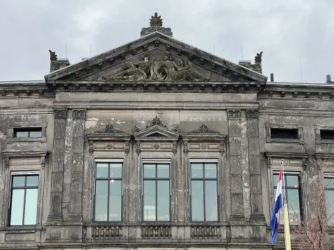

### Anne Frank House — `museum.anne-frank-house`

Tobias Niepel · [CC BY 2.0](https://creativecommons.org/licenses/by/2.0/) · [Original source](https://commons.wikimedia.org/wiki/File:Anne_Frank_House%2C_Amsterdam_%2826210793741%29.jpg) · 12 March 2016, 14:06. Resized WebP; no content edits.

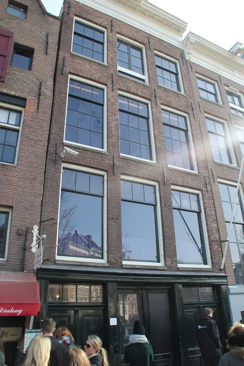

### Panorama Mesdag — `museum.den-haag-panorama-mesdag`

Marion Golsteijn · [CC BY-SA 3.0](https://creativecommons.org/licenses/by-sa/3.0/) · [Original source](https://commons.wikimedia.org/wiki/File:Panorama_Mesdag_08.jpg) · 5 August 2008. Resized WebP; no content edits.

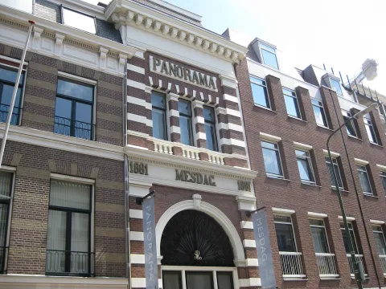

### DAF Museum — `museum.eindhoven-daf`

S. Perquin · [CC BY-SA 4.0](https://creativecommons.org/licenses/by-sa/4.0/) · [Original source](https://commons.wikimedia.org/wiki/File:DAF_Museum_(2024).jpg) · 4 May 2024, 11:12:50. Resized WebP; no content edits.

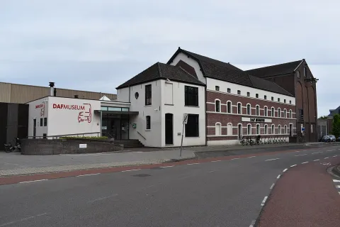

### Philips Museum — `museum.eindhoven-philips`

Lempkesfabriek · [CC BY-SA 3.0](https://creativecommons.org/licenses/by-sa/3.0/) · [Original source](https://commons.wikimedia.org/wiki/File:Philipsfabriekje.jpg) · July 2008. Resized WebP; no content edits.

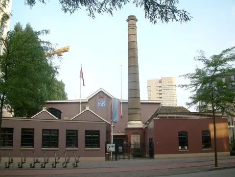

### Eye Filmmuseum — `museum.eye-filmmuseum`

Jvhertum · [CC BY-SA 3.0](https://creativecommons.org/licenses/by-sa/3.0/) · [Original source](https://commons.wikimedia.org/wiki/File:EYE_Filmmuseum.jpg) · 25 February 2012. Resized WebP; no content edits.

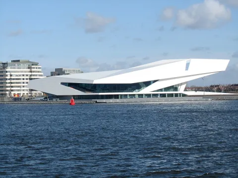

### Het Scheepvaartmuseum — `museum.het-scheepvaartmuseum`

PersianDutchNetwork · [CC BY-SA 3.0](https://creativecommons.org/licenses/by-sa/3.0/) · [Original source](https://commons.wikimedia.org/wiki/File:Het_Scheepvaartmuseum_Amsterdam%2C_Photo_by_Persian_Dutch_Network%2C_January_2012.jpg) · 2 January 2011. Resized WebP; no content edits.

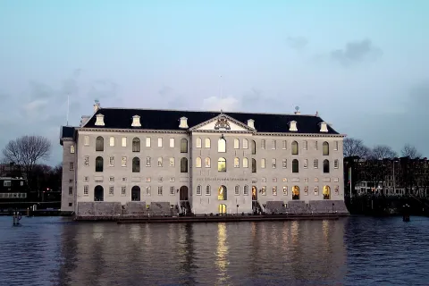

### Molenmuseum De Valk — `museum.leiden-de-valk`

Erik Zachte · [CC BY-SA 3.0](https://creativecommons.org/licenses/by-sa/3.0/) · [Original source](https://commons.wikimedia.org/wiki/File:MolenDeValkLeiden.jpg) · 16 June 2010. Resized WebP; no content edits.

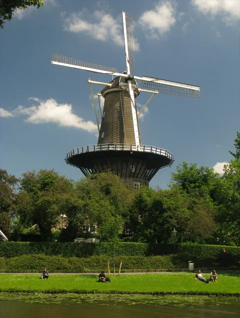

### Museum Ons' Lieve Heer op Solder — `museum.museum-ons-lieve-heer-op-solder`

Gary Ullah from Edinburgh, UK · [CC BY 2.0](https://creativecommons.org/licenses/by/2.0/) · [Original source](https://commons.wikimedia.org/wiki/File:Museum_Ons%27_Lieve_Heer_op_Solder%2C_Amsterdam_%288807517167%29.jpg) · 3 September 2012, 11:13. Resized WebP; no content edits.

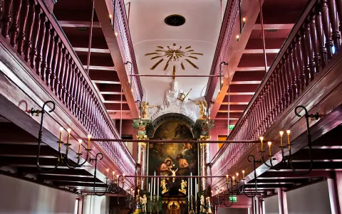

### Museum Rembrandthuis — `museum.museum-rembrandthuis`

Bysmon · [CC BY-SA 4.0](https://creativecommons.org/licenses/by-sa/4.0/) · [Original source](https://commons.wikimedia.org/wiki/File:Rembrandthuis%2C_Amsterdam%2C_2015-04-25b.jpg) · 25 April 2015. Resized WebP; no content edits.

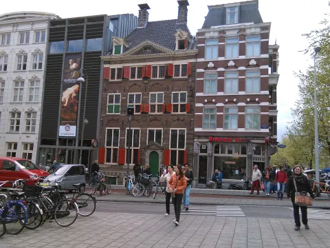

### Depot Boijmans Van Beuningen — `museum.rotterdam-boijmans`

Renate Hano · [CC BY-SA 4.0](https://creativecommons.org/licenses/by-sa/4.0/) · [Original source](https://commons.wikimedia.org/wiki/File:Depot_Boijmans_van_Beuningen_2025_(Osten).jpg) · 3 September 2025. Resized WebP; no content edits.

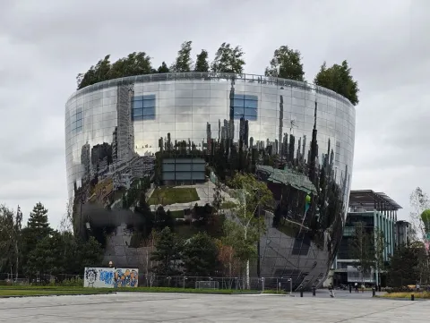

### Chabot Museum — `museum.rotterdam-chabot`

Szilas · [CC BY-SA 4.0](https://creativecommons.org/licenses/by-sa/4.0/) · [Original source](https://commons.wikimedia.org/wiki/File:Chabot_Museum.jpg) · 15 February 2009, 12:02:02. Resized WebP; no content edits.

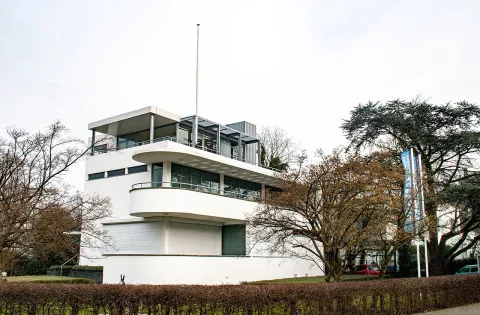

### Natuurhistorisch Museum Rotterdam — `museum.rotterdam-natuurhistorisch`

Guilhem Vellut from Annecy, France · [CC BY 2.0](https://creativecommons.org/licenses/by/2.0/) · [Original source](https://commons.wikimedia.org/wiki/File:Natuurhistorisch_Museum_@_Rotterdam_(29949323453).jpg) · 20 October 2016, 12:26. Resized WebP; no content edits.

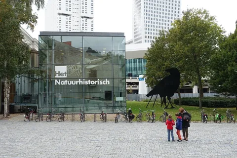

### Stedelijk Museum Amsterdam — `museum.stedelijk-museum-amsterdam`

John Lewis Marshall · [CC BY-SA 4.0](https://creativecommons.org/licenses/by-sa/4.0/) · [Original source](https://commons.wikimedia.org/wiki/File:De_nieuwe_vleugel_van_het_Stedelijk_Museum_Amsterdam.jpg) · 6 September 2013, 21:47:14. Resized WebP; no content edits.

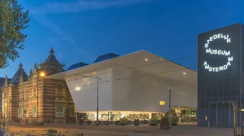

### Museum Catharijneconvent — `museum.utrecht-catharijneconvent`

FaceMePLS · [CC BY 2.0](https://creativecommons.org/licenses/by/2.0/) · [Original source](https://commons.wikimedia.org/wiki/File:Catharijneconvent_Utrecht.jpg) · 12 December 2012, 14:12:06. Resized WebP; no content edits.

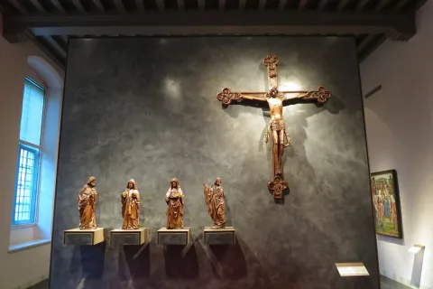

### Centraal Museum — `museum.utrecht-centraal`

Centraal Museum / fotograaf: Vincent Zedelius · [CC BY-SA 3.0](https://creativecommons.org/licenses/by-sa/3.0/) · [Original source](https://commons.wikimedia.org/wiki/File:Exterieur_Centraal_Museum.jpg) · 19 June 2012, 13:01:42. Resized WebP; no content edits.

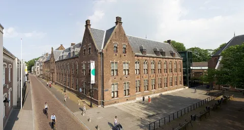

### Museum Speelklok — `museum.utrecht-speelklok`

artethgray · [CC BY 2.0](https://creativecommons.org/licenses/by/2.0/) · [Original source](https://commons.wikimedia.org/wiki/File:Inside_the_Museum_Speelklok.jpg) · 14 December 2011, 11:08:58. Resized WebP; no content edits.

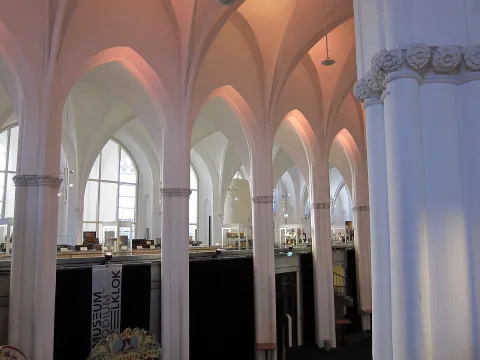

### Van Gogh Museum — `museum.van-gogh-museum`

Minke Wagenaar · [CC BY-SA 2.0](https://creativecommons.org/licenses/by-sa/2.0/) · [Original source](https://commons.wikimedia.org/wiki/File:WLANL_-_Minke_Wagenaar_-_Van_Gogh_Museum_Amsterdam_159.jpg) · 23 June 2009, 08:39. Resized WebP; no content edits.

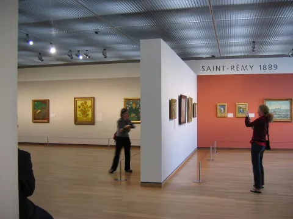

### Wereldmuseum Amsterdam — `museum.wereldmuseum-amsterdam`

Sneeuwvlakte · [CC BY-SA 4.0](https://creativecommons.org/licenses/by-sa/4.0/) · [Original source](https://commons.wikimedia.org/wiki/File:Wereldmuseum_Amsterdam_%282025%29.jpg) · 22 December 2025, 13:14:15. Resized WebP; no content edits.

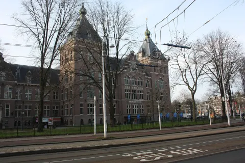

### Westbroekpark — `nature.den-haag-westbroekpark`

P.L. van Till at nl.wikipedia · [CC BY-SA 3.0](https://creativecommons.org/licenses/by-sa/3.0/) · [Original source](https://commons.wikimedia.org/wiki/File:Westbroekpark_rozenbedden.JPG) · 29 June 2008. Resized WebP; no content edits.

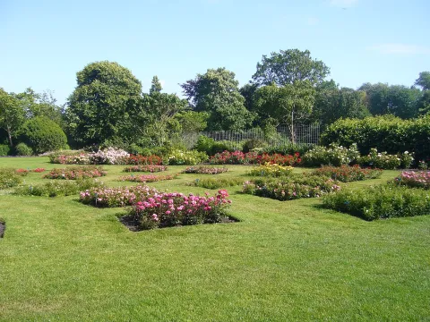

### Ankerpark — `nature.leiden-ankerpark`

Michiel1972 · [CC BY-SA 3.0](https://creativecommons.org/licenses/by-sa/3.0/) · [Original source](https://commons.wikimedia.org/wiki/File:Kanon_Ankerpark_Leiden.jpg) · 25 July 2009. Resized WebP; no content edits.

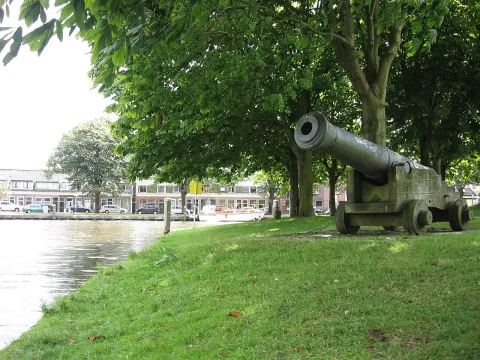

### Blekerspark — `nature.leiden-blekerspark`

Bic · [CC BY-SA 4.0](https://creativecommons.org/licenses/by-sa/4.0/) · [Original source](https://commons.wikimedia.org/wiki/File:Bleekerspark_Leiden.jpg) · 16 July 2014, 15:42:02. Resized WebP; no content edits.

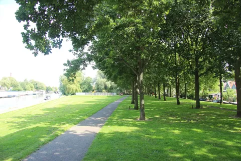

### Polderpark Cronesteyn — `nature.leiden-cronesteyn`

Ronald van der Graaf from Leiden, The Netherlands · [CC BY 2.0](https://creativecommons.org/licenses/by/2.0/) · [Original source](https://commons.wikimedia.org/wiki/File:Park_Cronesteyn_Park_Cronesteijn_(26870194233).jpg) · 5 June 2016, 11:59. Resized WebP; no content edits.

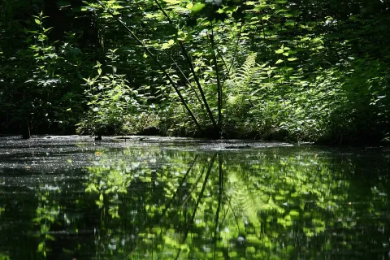

### Huigpark — `nature.leiden-huigpark`

Bic · [CC BY-SA 4.0](https://creativecommons.org/licenses/by-sa/4.0/) · [Original source](https://commons.wikimedia.org/wiki/File:Huigpark_Leiden.jpg) · 16 July 2014, 15:38:14. Resized WebP; no content edits.

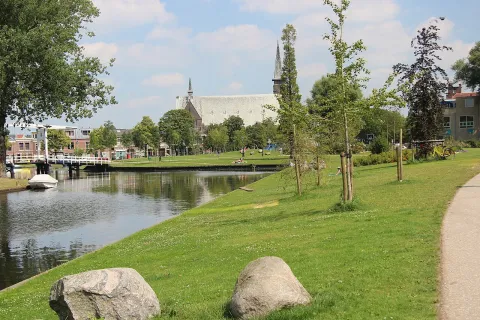

### Leidse Hout — `nature.leiden-leidse-hout`

Marianne Cornelissen-Kuyt · [CC BY-SA 4.0](https://creativecommons.org/licenses/by-sa/4.0/) · [Original source](https://commons.wikimedia.org/wiki/File:Leiden-Leidse_Hout-div_functies-01.jpg) · 24 September 2017. Resized WebP; no content edits.

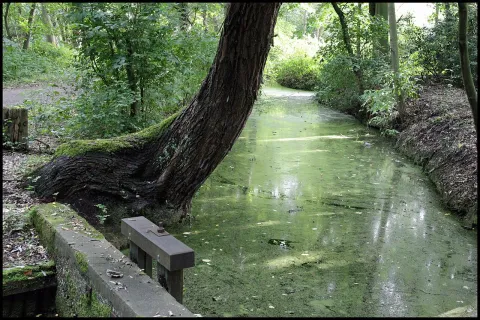

### Park de Put — `nature.leiden-park-de-put`

Xsandriel · [CC BY-SA 4.0](https://creativecommons.org/licenses/by-sa/4.0/) · [Original source](https://commons.wikimedia.org/wiki/File:Park_de_put_(1).JPG) · 5 March 2015, 12:07:44. Resized WebP; no content edits.

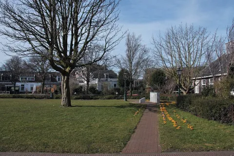

### Het Plantsoen — `nature.leiden-plantsoen`

Rudolphous · [CC BY-SA 4.0](https://creativecommons.org/licenses/by-sa/4.0/) · [Original source](https://commons.wikimedia.org/wiki/File:20210806_Leiden_-_Plantsoen_Park_%27Plantsoen%27.jpg) · 6 August 2021, 11:16:46. Resized WebP; no content edits.

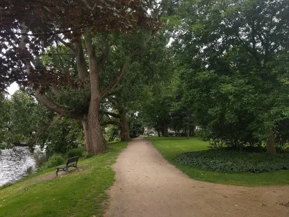

### Park Oog in Al — `nature.utrecht-oog-in-al`

Marcel030NL · [CC BY-SA 3.0](https://creativecommons.org/licenses/by-sa/3.0/) · [Original source](https://commons.wikimedia.org/wiki/File:Bruggetje_-_panoramio_-_Marcel030NL.jpg) · Taken on 8 November 2003. Resized WebP; no content edits.

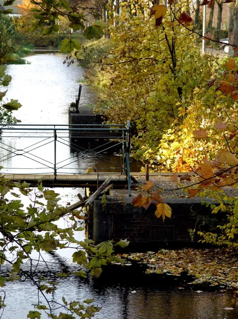

### Peace Palace — `place.den-haag-peace-palace`

Lybil BER · [CC BY-SA 4.0](https://creativecommons.org/licenses/by-sa/4.0/) · [Original source](https://commons.wikimedia.org/wiki/File:Peace_Palace_by_Night.jpg) · 21 September 2009. Resized WebP; no content edits.

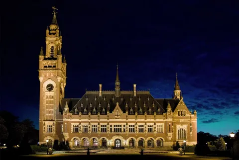

### Euromast — `place.rotterdam-euromast`

Guilhem Vellut from Annecy, France · [CC BY 2.0](https://creativecommons.org/licenses/by/2.0/) · [Original source](https://commons.wikimedia.org/wiki/File:Euromast%20%40%20Rotterdam%20%2829972520534%29.jpg) · 21 October 2016, 14:49. Resized WebP; no content edits.

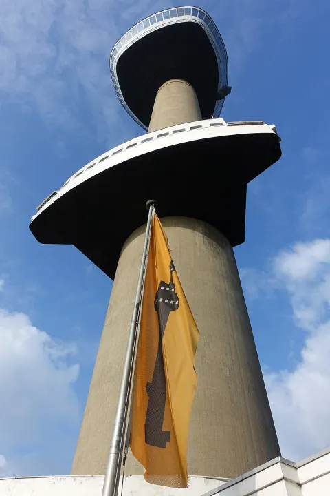

### Dom Tower — `place.utrecht-domtoren`

Victor van Werkhooven · [CC BY-SA 3.0](https://creativecommons.org/licenses/by-sa/3.0/) · [Original source](https://commons.wikimedia.org/wiki/File:Utrecht%20Dom%20Tower%20by%20Night.jpg) · 6 April 2012. Resized WebP; no content edits.

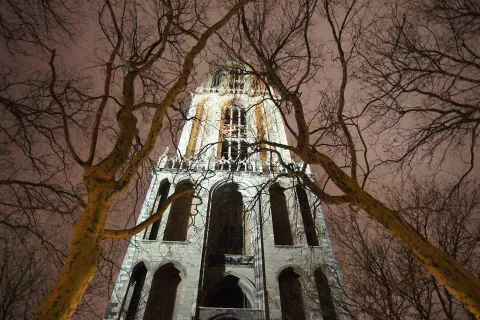

### Rietveld Schröder House — `place.utrecht-rietveld-schroderhuis`

ABrocke · [CC BY-SA 3.0](https://creativecommons.org/licenses/by-sa/3.0/) · [Original source](https://commons.wikimedia.org/wiki/File:P5050049_-_Rietveld_Schr%C3%B6der_House_01.JPG) · 5 May 2013. Resized WebP; no content edits.

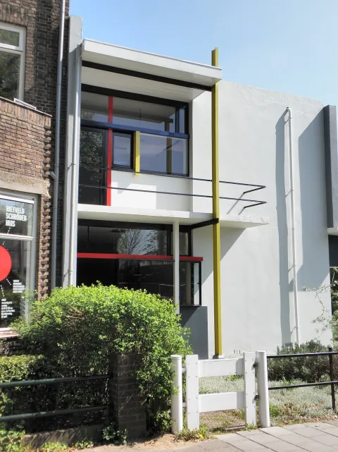

## Address coordinates

Official visitor addresses were matched exactly by street, house number, postcode (where supplied) and city to BAG via PDOK. These are address-object centroids, **not surveyed entrances**; no camera position or city centre is substituted. Source: Kadaster / PDOK, BAG, [CC0 1.0 metadata](https://data.overheid.nl/dataset/basisregistratie-adressen-en-gebouwen--bag-). Apple Maps has not been launched for runtime QA.

| ID | Official address matched to BAG | Latitude | Longitude |
|---|---|---:|---:|
| `museum.anne-frank-house` | Westermarkt 20, 1016DK Amsterdam | 52.37493637 | 4.88431719 |
| `museum.den-haag-beelden-aan-zee` | Harteveltstraat 1, 2586EL 's-Gravenhage | 52.110936 | 4.27840114 |
| `museum.den-haag-escher` | Lange Voorhout 74, 2514EH 's-Gravenhage | 52.08340076 | 4.31417352 |
| `museum.den-haag-gevangenpoort` | Buitenhof 33, 2513AH 's-Gravenhage | 52.07959563 | 4.31027908 |
| `museum.den-haag-louwman` | Leidsestraatweg 57, 2594BB 's-Gravenhage | 52.09961462 | 4.34858837 |
| `museum.den-haag-museon-omniversum` | Stadhouderslaan 37, 2517HV 's-Gravenhage | 52.0890557 | 4.2807185 |
| `museum.eindhoven-daf` | Tongelresestraat 27, 5613DA Eindhoven | 51.43722081 | 5.49042939 |
| `museum.eindhoven-philips` | Emmasingel 31, 5611AZ Eindhoven | 51.43931451 | 5.47524132 |
| `museum.eindhoven-prehistorisch-dorp` | Boutenslaan 161B, 5644TV Eindhoven | 51.42213925 | 5.4767892 |
| `museum.eindhoven-van-abbe` | Stratumsedijk 2, 5611ND Eindhoven | 51.43441483 | 5.48191358 |
| `museum.hart-museum` | Amstel 51, 1018EJ Amsterdam | 52.36563495 | 4.90222598 |
| `museum.het-scheepvaartmuseum` | Kattenburgerplein 1, 1018KK Amsterdam | 52.37149196 | 4.91500002 |
| `museum.leiden-sieboldhuis` | Rapenburg 19, 2311GE Leiden | 52.15964141 | 4.48461576 |
| `museum.museum-of-the-canals` | Herengracht 386, 1016CJ Amsterdam | 52.36788669 | 4.8862747 |
| `museum.nemo-science-museum` | Oosterdok 2, 1011VX Amsterdam | 52.37385316 | 4.91211135 |
| `museum.rotterdam-foto` | Brede Hilledijk 95, 3072KD Rotterdam | 51.9027092 | 4.49519381 |
| `museum.rotterdam-kunsthal` | Westzeedijk 341, 3015AA Rotterdam | 51.91067289 | 4.47338557 |
| `museum.rotterdam-maritime` | Leuvehaven 1, 3011EA Rotterdam | 51.91750027 | 4.48244223 |
| `museum.rotterdam-natuurhistorisch` | Westzeedijk 345, 3015AA Rotterdam | 51.91078696 | 4.47255117 |
| `museum.stedelijk-museum-amsterdam` | Museumplein 10, 1071DJ Amsterdam | 52.35790993 | 4.87985492 |
| `museum.utrecht-catharijneconvent` | Lange Nieuwstraat 38, 3512PH Utrecht | 52.08728915 | 5.12392418 |
| `museum.utrecht-centraal` | Agnietenstraat 1, 3512XA Utrecht | 52.08380965 | 5.12595732 |
| `museum.utrecht-speelklok` | Steenweg 6, 3511JP Utrecht | 52.09050772 | 5.11891006 |
| `museum.utrecht-spoorwegmuseum` | Maliebaanstation 16, 3581XW Utrecht | 52.08795942 | 5.13107733 |
| `place.eindhoven-evoluon` | Noord Brabantlaan 1A, 5652LA Eindhoven | 51.44361096 | 5.4468137 |
| `place.leiden-schouwburg` | Oude Vest 43, 2312XS Leiden | 52.16240092 | 4.48918582 |
| `place.leiden-young-rembrandt-studio` | Langebrug 89, 2311TJ Leiden | 52.15761434 | 4.48974704 |
| `place.rotterdam-blijdorp` | Blijdorplaan 8, 3041JG Rotterdam | 51.92801151 | 4.44355811 |
| `place.rotterdam-euromast` | Parkhaven 20, 3016GM Rotterdam | 51.90540245 | 4.46651217 |
| `place.rotterdam-kijk-kubus` | Overblaak 70, 3011MH Rotterdam | 51.92018545 | 4.4905688 |
| `place.rotterdam-laurenskerk` | Grotekerkplein 15, 3011GC Rotterdam | 51.92145122 | 4.48490308 |
| `place.rotterdam-markthal` | Ds. Jan Scharpstraat 298, 3011GZ Rotterdam | 51.91977096 | 4.48625924 |
| `place.utrecht-rietveld-schroderhuis` | Prins Hendriklaan 50, 3583EP Utrecht | 52.08532347 | 5.14751902 |

## Collections

| ID | Members |
|---|---|
| `collection.leiden-culture-review-20261115` | `place.leiden-vvv`, `place.leiden-burcht`, `place.leiden-hortus`, `place.leiden-rmo`, `place.leiden-lakenhal`, `place.leiden-naturalis`, `museum.leiden-boerhaave`, `museum.leiden-wereldmuseum`, `place.leiden-cafe-laken`, `museum.leiden-de-valk`, `museum.leiden-sieboldhuis`, `place.leiden-pieterskerk`, `place.leiden-young-rembrandt-studio`, `place.leiden-schouwburg` |
| `collection.amsterdam-culture-review-20261115` | `museum.rijksmuseum`, `museum.van-gogh-museum`, `museum.stedelijk-museum-amsterdam`, `museum.anne-frank-house`, `museum.nemo-science-museum`, `museum.het-scheepvaartmuseum`, `museum.museum-rembrandthuis`, `museum.museum-ons-lieve-heer-op-solder`, `museum.hart-museum`, `museum.jewish-museum`, `museum.dutch-resistance-museum`, `museum.eye-filmmuseum`, `museum.museum-of-the-canals`, `museum.huis-marseille`, `museum.allard-pierson`, `museum.wereldmuseum-amsterdam`, `place.royal-palace-amsterdam` |
| `collection.rotterdam-culture-review-20261115` | `museum.rotterdam-chabot`, `museum.rotterdam-boijmans`, `museum.rotterdam-kunsthal`, `museum.rotterdam-maritime`, `place.rotterdam-euromast`, `place.rotterdam-kijk-kubus`, `place.rotterdam-markthal`, `museum.rotterdam-natuurhistorisch`, `museum.rotterdam-foto`, `place.rotterdam-blijdorp`, `place.rotterdam-laurenskerk` |
| `collection.den-haag-culture-review-20261115` | `museum.den-haag-fotomuseum`, `museum.den-haag-escher`, `museum.den-haag-panorama-mesdag`, `museum.den-haag-museon-omniversum`, `place.den-haag-peace-palace`, `museum.den-haag-gevangenpoort`, `museum.den-haag-beelden-aan-zee`, `museum.den-haag-louwman` |
| `collection.utrecht-culture-review-20261115` | `place.utrecht-neude`, `museum.utrecht-sonnenborgh`, `museum.utrecht-centraal`, `museum.utrecht-spoorwegmuseum`, `museum.utrecht-speelklok`, `museum.utrecht-catharijneconvent`, `place.utrecht-domtoren`, `museum.utrecht-domunder`, `museum.utrecht-nijntje`, `place.utrecht-rietveld-schroderhuis`, `museum.utrecht-university-museum` |
| `collection.eindhoven-culture-review-20261115` | `museum.eindhoven-inkijkmuseum`, `museum.eindhoven-van-abbe`, `museum.eindhoven-philips`, `museum.eindhoven-daf`, `museum.eindhoven-prehistorisch-dorp`, `place.eindhoven-evoluon`, `place.eindhoven-muziekgebouw`, `place.eindhoven-dynamo`, `place.eindhoven-piet-hein-eek` |

## Held material

- `museum.den-haag-kunstmuseum`: Entity primary-source content remains unresolved; photo stays in review until that is checked.
- `museum.den-haag-mauritshuis`: Entity primary-source content remains unresolved; photo stays in review until that is checked.
- `museum.eindhoven-prehistorisch-dorp`: Construction-stage exterior; unsuitable as the current visitor hero. Retain as historical review evidence.
- `museum.foam`: Wrong subject: scanned soap foam, not the museum. Correct Commons category is Fotografiemuseum Amsterdam.
- `museum.museum-van-loon`: Entity primary-source content remains unresolved; photo stays in review until that is checked.
- `place.den-haag-madurodam`: Entity primary-source content remains unresolved; photo stays in review until that is checked.
- `place.eindhoven-park-theatre`: Backstage corridor rather than visitor-facing theatre experience; keep out of hero selection.
- `place.rotterdam-markthal`: Binnenrotte streetscape with only a small edge of Markthal; insufficient subject emphasis.
- `museum.dutch-resistance-museum`: Expected one exact address; found 0
- `place.eindhoven-muziekgebouw`: Expected one exact address; found 0

Source checks still pending: `place.leiden-oude-sterrewacht`, `museum.foam`, `museum.artis-micropia`, `museum.museum-van-loon`, `museum.den-haag-mauritshuis`, `museum.den-haag-kunstmuseum`, `place.den-haag-madurodam`, `place.eindhoven-strijp-s`, `place.eindhoven-park-theatre`.

## Decision requested

Approve only this selection (57 records / 32 photos / 33 coordinates / 6 collections) bound to SHA-256 `d00afc1621010eba612be3dc397c08a3b0f3a2633538fbe825697b00b8e0dca7`, for subsequent governed integration into a local iOS candidate. Excluded material stays in review; production, TestFlight, App Store and automatic merging remain outside scope.

A separate approval receipt must cite the actual human decision and exact hash. This generator never supplies a reviewer identity or publication permission.
